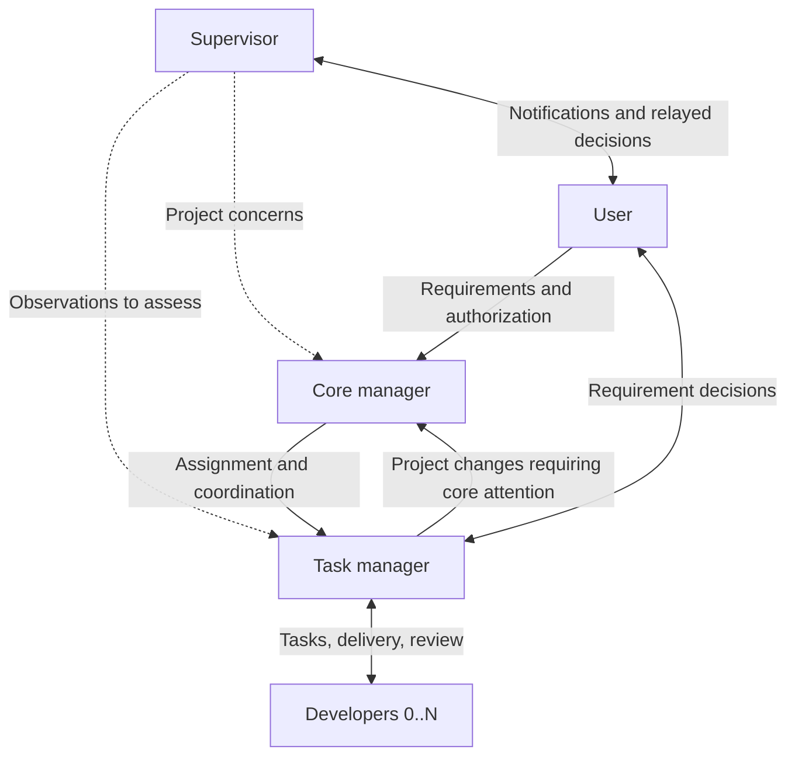

# Multi-Agent Collaboration

[中文](README.md) | English

An Agent Skill for development across multiple conversations. Stable roles, explicit delivery boundaries, and concise documents let replaceable agent sessions work together over long tasks.

This repository provides collaboration rules, role guides, templates, and an optional creation script. Agent clients, CLIs, MCP integrations, or external supervisors provide execution, messaging, wakeups, and observation. Installing the skill does not start a background service or guarantee unattended operation.

## Roles

| Role | Responsibility |
|---|---|
| Core manager | Receive requirements, assign task managers, coordinate dependencies and project-level risks |
| Task manager | Analyze and decompose a requirement, implement when useful, manage developers, review, and deliver |
| Developer | Implement a bounded work package, validate it, freeze it for review, and address feedback; multiple developers are supported |
| Supervisor | Independently observe progress, raise concerns with an appropriate manager, and relay user decisions |

Each project has one current core manager, and each requirement has one current task manager. Roles are independent of vendors and models. Developers can join later; the user creates the supervisor. Every role may initiate its own session handoff, provided responsibility, registration, and relevant notifications are handled.



## Installation

Place the repository in a skill directory supported by your client. This example uses the user-level `~/.agents/skills/` directory; configure other clients according to their discovery mechanism.

```bash
mkdir -p ~/.agents/skills
git clone git@github.com:ElvisKang/multi-agent-collaboration.git \
  ~/.agents/skills/multi-agent-collaboration
```

If an installation already exists, inspect local changes before replacing it. With a clean working tree and the intended branch configured, update with:

```bash
git -C ~/.agents/skills/multi-agent-collaboration pull --ff-only
```

Have each participant read [SKILL.md](SKILL.md) and its own role guide. Load other references when the corresponding operation occurs. To apply changed rules to an existing conversation, explicitly ask it to reread the entry point and affected references.

## Getting started

1. Reference the skill in the project's `AGENTS.md` or `HANDOFF.md`, including coordination paths, role preferences, and permissions.
2. Create or appoint a core manager and provide the requirement and scope of autonomous work.
3. The core manager assigns a task manager, who implements directly or uses developers as appropriate.
4. Each session initially reports its real session ID, role, task, main working tree, and development directory, and maintains its actual binding.
5. Implement, validate, freeze for review, review, and dispatch subsequent work until the complete requirement is accepted and closed.

Example startup instruction:

```text
Use multi-agent-collaboration. You are this project's core manager.
Read SKILL.md, the core-manager guide, and the project's AGENTS/HANDOFF.
Establish the requirement, permissions, and current state before proceeding.
Use project settings for agents, models, creation methods, and additional constraints.
```

Project conventions override the skill's defaults, subject to system and tool constraints. Codex/MiMo tools and models are adapter examples; when clients change or another agent is used, select a supported equivalent. If a matching model cannot be found, omit the model parameter and use the client's default configuration.

## Principles

- **Keep moving:** freezing a work package for review does not pause the requirement. After approval, the manager advances the next authorized action.
- **Replace responsibly:** notify the previous executor of removal, confirm release of responsibility and related writes, then authorize the successor. A CLI exit does not mean a session has relinquished its task.
- **Control concurrency:** multiple developers may participate, but only one actual writer operates in a given worktree at a time. Parallel coding uses authorized isolated workspaces.
- **Investigate unknown outcomes:** interruption, timeout, or an empty response does not establish failure. Track the original operation before creating or dispatching another one.
- **Filter by responsibility:** routine reviews, fixes, and investigation stay within the requirement team. Escalate material changes that require core action or affect project arrangements.
- **Assess supervision:** managers verify a supervisor's observations before acting. An observation is not a scheduling instruction.
- **No TDD by default:** use TDD only when project documentation explicitly requires it. Perform necessary validation without automatically adding another development process.
- **Keep permissions distinct:** session creation, code changes, builds, flashing, commits, and publication are separate authorization boundaries.

## Documents and local state

Keep durable constraints, baselines, and conclusions in shared project documents. Store runtime task records, real session bindings, and machine-specific evidence locations in a project-local directory, for example:

```text
<main-worktree>/<project>/.local/coordination/
├── TASKS.md             # Tasks and actual write owner
├── sessions.md          # Current routing snapshot, plain YAML
├── handoffs/            # Current task handoffs
└── evidence.md          # Local evidence locations
```

Projects choose their paths and should add appropriate Git ignore rules. `sessions.md` describes current identities, bindings, and routes; it is not a message log or a real-time execution monitor. Shared configuration uses portable paths and preferences. Credentials and machine-specific runtime records do not belong in this skill repository.

## Reference map

| Situation | Read |
|---|---|
| Project coordination | [Core manager](references/roles/core-manager.md) |
| Requirement delivery | [Task manager](references/roles/task-manager.md) |
| Daily implementation | [Developer loop](references/roles/developer.md) |
| Observation and assessment | [Supervisor](references/roles/supervisor.md) · [Handling concerns](references/supervision.md) |
| Stages, waiting, and completion | [Lifecycle terminology](references/task-lifecycle.md) |
| Registration and handoff | [Coordination](references/coordination.md) · [Routing schema](references/session-schema.md) |
| Creation, configuration, messaging | [Creation](references/session-creation.md) · [Environment adapters](references/environment.md) · [Messaging](references/cli-routing.md) |
| Delegation, stopping, and validation issues | [Execution guidance](references/implementation-guidance.md) |
| Durable and temporary records | [Document lifecycle](references/document-lifecycle.md) |

`assets/` contains reusable templates. `scripts/create-session.sh` is an optional Codex/MiMo creation adapter requiring Bash, Python 3.11+, Git, and the corresponding CLI; use `--help` for parameters. It does not unify every agent's native session API or provide continuous monitoring.

## Maintenance

[SKILL.md](SKILL.md) and its references define the behavior; the README is a user-facing overview. Validate applicable changes and commit them according to [repository maintenance rules](AGENTS.md). Keep real task logs, credentials, and conversation histories outside the reusable skill.

The operational guides and templates are currently written in Chinese; this README provides an English overview, not a separate English edition of the entire skill.
