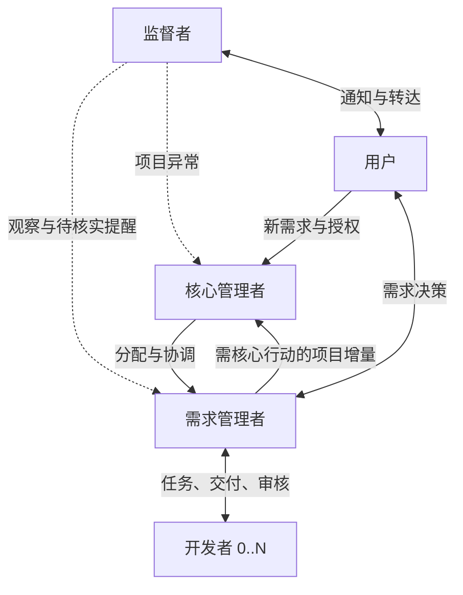

# Multi-Agent Collaboration

中文 | [English](README.en.md)

面向跨会话持续研发的 Agent Skill：用稳定的角色、明确的交付边界和精简文档，协调多个可接力的 Agent 会话。

本项目提供协作规则、角色指导、模板及可选创建脚本。实际的会话执行、消息投递、持续唤醒和状态观察由 Agent 客户端、CLI、MCP 或外部监督工具提供；安装本技能本身不会启动后台服务，也不保证无人值守运行。

## 角色与职责

| 角色 | 职责 |
|---|---|
| 核心管理者 | 接收新需求、分配需求管理者、协调跨需求依赖和项目级风险 |
| 需求管理者 | 需求分析、任务拆解、必要编码、开发者管理、审核和最终交付 |
| 开发者 | 完成有界实现、必要自验、冻结待审及修复，可按需多个 |
| 监督者 | 独立观察进度、向适当管理者提示疑点、代用户转达决定 |

每个项目有一个当前有效核心，每个需求有一个当前有效管理者。角色不绑定厂商或模型；开发者可中途加入，监督者由用户创建。各角色都可自主创建自己的接力会话，但须完成职责移交、登记与相关通知。



## 安装

将仓库放入客户端支持的技能目录。下面使用用户级目录 `~/.agents/skills/`；其他客户端按其技能发现方式配置。

```bash
mkdir -p ~/.agents/skills
git clone git@github.com:ElvisKang/multi-agent-collaboration.git \
  ~/.agents/skills/multi-agent-collaboration
```

已存在同名安装时先检查本地修改，避免覆盖。更新可以在工作区干净且分支配置正确时执行：

```bash
git -C ~/.agents/skills/multi-agent-collaboration pull --ff-only
```

让参与协作的 Agent 读取 [SKILL.md](SKILL.md) 和自身角色页即可。其他参考按操作加载，无需每次读取全部文档。运行中的旧会话需要采用新规则时，显式通知其重读入口和受影响的参考页。

## 开始使用

1. 在项目 `AGENTS.md` 或 `HANDOFF.md` 中指定本技能、协作目录、角色偏好及操作权限。
2. 创建或指定核心管理会话，给出需求目标和可自主执行的范围。
3. 核心安排需求管理者；需求管理者根据复杂度自行实现或使用开发者。
4. 各会话首次输出真实 sessionId、角色、任务、主工作区和开发目录，并维护实际绑定。
5. 按工作包实现、自验、冻结待审、审核与续派，直至整体验收及关闭。

可作为启动说明：

```text
使用 multi-agent-collaboration。你是本项目的核心管理者。
先读 SKILL.md、核心角色页和项目 AGENTS/HANDOFF，明确需求、权限与当前状态。
角色所用 Agent、模型、创建方式和额外限制按项目配置执行。
```

项目约定优先于技能默认值，同时遵守系统和工具约束。当前 Codex/MiMo 的工具与模型说明属于适配示例；客户端更新或使用其他 Agent 时，选择当前受支持的等效能力。找不到匹配模型时可省略模型参数，使用客户端默认配置。

## 关键原则

- **持续推进**：冻结待审只固定工作包版本；管理者审核通过后推进下一项已授权工作，阶段汇报不是任务终点。
- **安全替换**：明确通知旧执行者撤任，确认职责和相关写入释放，再授权继任者。CLI 退出不等于会话退任。
- **受控并行**：多个开发者可以并存；同一 worktree 同时只有一个实际 writer，并行编码使用已授权的隔离工作区。
- **结果未知先追踪**：中断、超时、空返回不等于执行失败，不直接重复创建、派发或投递。
- **按层级过滤消息**：日常审核、修复和取证留需求组，只有需核心行动或影响项目安排的重要增量才上报核心。
- **监督需判断**：管理者核实监督者的观察，再决定处理；观察本身不是调度指令。
- **默认非 TDD**：仅在项目文档明确要求时启用 TDD，保留实际所需验证；开发者不自动叠加额外研发流程。
- **权限分别管理**：会话创建、代码写入、构建、烧录、提交和发布的授权不互相替代。

## 文档与本地状态

推荐将长期项目约束、基线和结论保存在可共享文档中；任务运行记录、真实会话绑定和本机证据位置留在项目本地目录。例如：

```text
<主工作区>/<项目目录>/.local/coordination/
├── TASKS.md             # 任务及实际写入 Owner
├── sessions.md          # 当前路由快照，纯 YAML
├── handoffs/            # 当前任务交接
└── evidence.md          # 本机证据位置
```

目录由项目定义，并应加入相应 Git 忽略规则。`sessions.md` 描述当前身份、绑定和路由，不是消息流水或实时运行状态。共享配置使用可移植路径和偏好，密钥及机器专属记录不提交到本仓库。

## 按需参考

| 场景 | 文档 |
|---|---|
| 核心管理 | [核心角色](references/roles/core-manager.md) |
| 需求交付 | [需求管理角色](references/roles/task-manager.md) |
| 日常实现 | [开发者五步循环](references/roles/developer.md) |
| 监督和异常判断 | [监督角色](references/roles/supervisor.md) · [提醒处理](references/supervision.md) |
| 阶段、等待和结束术语 | [生命周期](references/task-lifecycle.md) |
| 登记与接力 | [协调流程](references/coordination.md) · [路由格式](references/session-schema.md) |
| 创建、配置与消息 | [创建](references/session-creation.md) · [环境适配](references/environment.md) · [通信](references/cli-routing.md) |
| 派生、停止与验证异常 | [执行细则](references/implementation-guidance.md) |
| 长期资料与临时记录 | [文档分层](references/document-lifecycle.md) |

`assets/` 提供通用模板。`scripts/create-session.sh` 是可选的 Codex/MiMo 创建适配入口，需要 Bash、Python 3.11+、Git 和对应 CLI；用 `--help` 查看参数。它不会把所有 Agent 的原生会话能力统一成同一种 API，也不负责持续监控。

## 维护

行为规则以 [SKILL.md](SKILL.md) 及其引用为准；README 面向使用者提供概览。修改后运行适用校验，再按 [仓库维护约定](AGENTS.md) 提交。不要将真实任务日志、密钥或会话历史混入通用技能。
